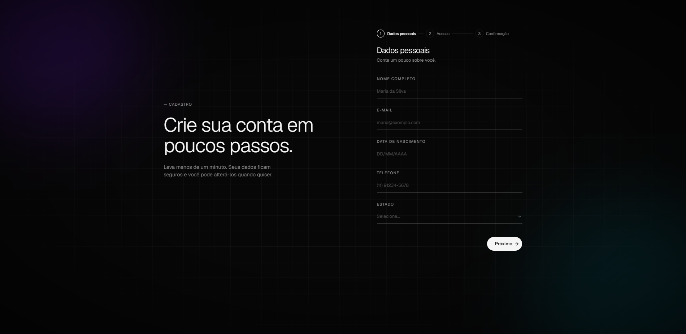
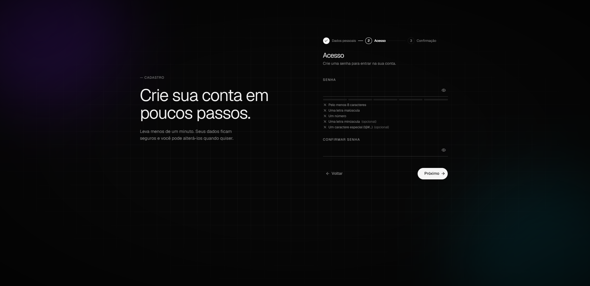
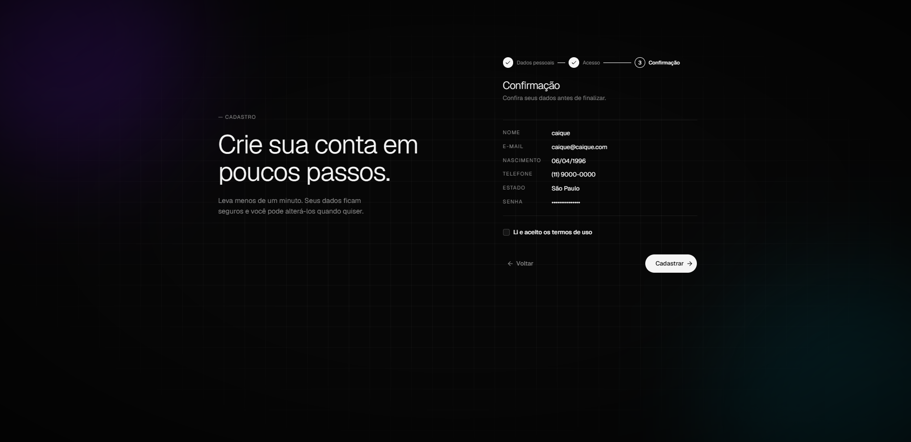

# Formulário de Cadastro

Formulário de cadastro em etapas, feito com React e TypeScript. Projeto de estudo com foco em validação de formulários, experiência do usuário, acessibilidade e testes automatizados.

> Por enquanto é só frontend: o envio é simulado. O backend será a próxima etapa.

## Telas

| Dados pessoais | Acesso | Confirmação |
|:---:|:---:|:---:|
|  |  |  |

## Funcionalidades

- **Cadastro em 3 etapas** (dados pessoais, acesso e confirmação), com indicador de progresso e validação por etapa antes de avançar
- **Validação com Zod**: mensagens de erro claras para cada campo, incluindo regras que dependem de mais de um campo (confirmação de senha)
- **Máscaras** de telefone (fixo e celular) e de data, aplicadas enquanto a pessoa digita
- **Data de nascimento** com verificação de data real (31/02, anos bissextos) e idade mínima de 18 anos
- **Medidor de força da senha** com a lista de critérios atendidos
- **Rascunho automático** no `localStorage`: os dados digitados voltam se a página for recarregada (a senha nunca é salva)
- **Tela de sucesso** com o resumo do cadastro
- **Animações** entre etapas, desligadas para quem ativa "reduzir movimento" no sistema
- **Acessibilidade**: rótulos ligados aos campos, erros anunciados e gerenciamento de foco
- **Fundo feito só com CSS**, sem imagens

## Tecnologias

- [React 19](https://react.dev) + [TypeScript](https://www.typescriptlang.org)
- [Vite](https://vite.dev) para desenvolvimento e build
- [Tailwind CSS 4](https://tailwindcss.com) + [shadcn/ui](https://ui.shadcn.com)
- [React Hook Form](https://react-hook-form.com) + [Zod](https://zod.dev) para formulário e validação
- [Sonner](https://sonner.emilkowal.ski) para notificações
- [Vitest](https://vitest.dev) + [Testing Library](https://testing-library.com) para testes
- [Oxlint](https://oxc.rs) para lint

## Como rodar

Pré-requisito: [Node.js](https://nodejs.org) 22 ou mais recente.

```bash
# instalar as dependências
npm install

# rodar em modo de desenvolvimento (http://localhost:5173)
npm run dev
```

### Outros comandos

| Comando | O que faz |
|---|---|
| `npm test` | Roda os testes e fica observando mudanças |
| `npx vitest run` | Roda os testes uma única vez |
| `npm run lint` | Verifica o código com o Oxlint |
| `npm run build` | Gera a versão de produção na pasta `dist/` |
| `npm run preview` | Abre localmente a versão de produção |

## Estrutura do projeto

```
src/
├── components/
│   ├── cadastro/     # etapas do formulário, tela de sucesso e resumo
│   └── ui/           # componentes base do shadcn/ui
├── lib/              # funções puras: datas, máscaras, força da senha, rascunho
├── schemas/          # regras de validação com Zod
└── test/             # configuração dos testes
```

As regras ficam separadas da interface: as funções em `lib/` e o schema em `schemas/` não dependem do React, o que facilita reaproveitar e testar.

## Testes

São 29 testes, de dois tipos:

- **Unitários**: máscaras, cálculo de idade, validação de datas e regras do schema
- **De componente**: simulam uma pessoa usando o formulário (clicar, digitar) e conferem os erros, a máscara e o rascunho

```bash
npm test
```
